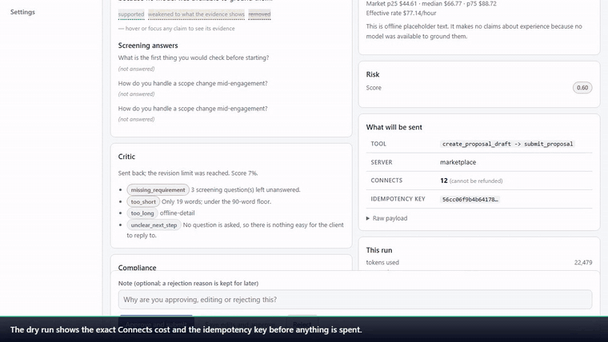

# GigBid

**A multi-agent copilot that finds freelance work worth bidding on, drafts
proposals grounded in real portfolio evidence, and never sends anything without
a human approving it.**

Freelancers lose hours scanning job feeds, spend Connects on jobs they will not
win, and send proposals that claim experience they cannot back up. GigBid does
the scanning, the judging and the drafting. The freelancer makes every decision
that reaches a client.



> **Live:** _add the deployed URL here_ · reviewer login in the Google Classroom
> private comment
> **Demo video:** _add the 3-minute link here_
> **Portfolio MCP server:** [`mcp_servers/portfolio`](mcp_servers/portfolio) —
> point Claude Desktop or Cursor at it and use it on your own portfolio

---

## The one thing worth knowing

Prompt-based defences against injected job posts **did not work**, and the
measurement says so clearly:

| Attack set | Detection |
| --- | --- |
| The 8 planted attacks the patterns were written against | **8 / 8** |
| 8 paraphrases, written blind | **2 / 8** |
| 8 held-out attacks, written afterwards and never tuned against | **0 / 8** |

Pattern matching catches almost nothing it was not written for. What actually
protects the user is structural: **no analysis agent holds a write tool, and
the one that does refuses without a human approval token** — 6/6 attempts
blocked, asserted by test rather than sampled.

That finding changed the CI gate. It no longer gates on detection rate, because
gating on it would have been gating on memorisation.

→ [`evals/results/injection_defence.json`](evals/results/injection_defence.json)

---

## Quick start

```bash
cp .env.example .env     # set APP_SECRET_KEY and REVIEWER_PASSWORD
make install
make seed                # corpus, jobs, dev set (seed 20261115)
make up                  # web :3000 · api :8000 · gigsim :8081
```

GigBid runs **with no API key** on a deterministic offline provider: the whole
graph executes, but the proposal text and the fit/risk scores are placeholders,
and the UI says so with a persistent banner. For real output set
`OPEN_LLM_BASE_URL` and `OPEN_LLM_API_KEY` (any OpenAI-compatible provider —
Groq, OpenRouter, Together, Ollama, vLLM).

Full instructions and failure modes: [`docs/RUNBOOK.md`](docs/RUNBOOK.md).

---

## Architecture

```
        ┌── Send() ──→ Job Analyst ────┐
START ──┼── Send() ──→ Risk Assessor ──┼──→ join ──→ decide ──→ skip / watch
        └── Send() ──→ Fit Matcher ────┘                 │
                                                        bid
                                                         │
   Pricing ──→ Writer ──→ Verify claims ──→ Critic ──(max 2 revisions)──┘
                                              │
                   Compliance Guard ──→ blocked ──→ END
                              │
                   ┌──── interrupt() ────┐     ← nothing has been sent
                 reject      edit      approve
                   │          │           │
                  END   re-check      Submit (exactly once)
```

Nine agents across two durable graphs, three MCP servers, one marketplace port
with two adapters. Full diagram and the reasoning behind each piece:
[`docs/ARCHITECTURE.md`](docs/ARCHITECTURE.md).

Three decisions worth defending:

- **`Send()` fan-out, not sequential edges.** The three analyses read nothing
  from each other, so the critical path is the slowest of the three rather than
  their sum.
- **Claim verification runs *before* the Critic.** A fabricated sentence is
  often the most persuasive one in a draft; letting the Critic see it first
  means it defends exactly what must be deleted. → [ADR 0002](docs/adr/0002-claim-verification-before-critic.md)
- **An edit re-enters Compliance.** A human can introduce a violation — most
  obviously their own email address. Trusting the earlier verdict would make
  the guard decorative.

---

## R&D results

Every number below traces to a committed file in
[`evals/results/`](evals/results/). Numbers produced without an API key are
tagged `provider: offline_stub` in the artefact and are **not** quoted here as
model-quality measurements.

### B — Retrieval: which design finds the right evidence?

Measured on 90 gold-labelled dev jobs, bge-small embeddings, 954 chunks.

| Variant | Recall@5 | nDCG@10 | **project hit@5** | project MRR | distinct projects@5 | p95 |
| --- | --- | --- | --- | --- | --- | --- |
| V7 HyDE | 0.527 | **0.538** | **1.000** | 0.832 | 3.70 | 864 ms |
| **V4 outcome-aware — ships** | **0.513** | 0.531 | **1.000** | **0.857** | 3.97 | **484 ms** |
| V2 hybrid BM25 + dense | 0.464 | 0.532 | **1.000** | **0.857** | 3.90 | 933 ms |
| V6 contextual¹ | 0.464 | 0.532 | **1.000** | 0.857 | 3.90 | 544 ms |
| V3 cross-encoder rerank | 0.384 | 0.491 | **1.000** | 0.752 | 3.90 | 549 ms |
| V5 multi-vector | 0.200 | 0.210 | **1.000** | 0.850 | 4.93 | 567 ms |
| V0 naive dense (baseline) | **0.656** | **0.587** | 0.989 | 0.848 | 2.08 | 357 ms |
| V1 requirement decomposition | 0.271 | 0.264 | 0.911 | 0.636 | 4.53 | 891 ms |
| V9 skill graph | 0.144 | 0.137 | 0.722 | 0.471 | 5.00 | 604 ms |
| V8 corrective RAG | 0.127 | 0.123 | 0.411 | 0.322 | 2.18 | 1,698 ms |

¹ V6 is **identical to V2** on this corpus: context prefixes are applied at
ingestion for every variant, so it is not an independent arm. A flaw in the
comparison, recorded rather than hidden; the ablation's `no_context` row
measures the prefixes properly. → [`evals/results/rag_variants.json`](evals/results/rag_variants.json)

**The baseline tops Recall@5 and nDCG@10, and that is a metric artifact.** Gold
evidence for a job is one project's items, so item-level recall *rewards
concentration*: V0 scores highly because it returns near-identical views of the
same project — 2.08 distinct projects in its top 5 against 3.97 for V4. It is
not finding more, it is finding the same thing repeatedly, which is the exact
failure the corpus was built to expose.

`project_hit@5` asks what the Writer depends on — did the right project reach
the top k? V0 misses on 1.1% of jobs; six variants never miss. **V4 ships**: it
has the best item recall of that group bar HyDE (0.513 vs 0.527), joint-best
project MRR, is 44% faster, and costs no LLM call per query where HyDE spends
tokens on every retrieval. → [ADR 0004](docs/adr/0004-rag-variant.md)

**Three negative results, reported as findings:**

- **V1 decomposition halved recall** (0.271). The hypothesis that splitting a
  job into per-requirement queries raises evidence recall is **not supported**
  on this corpus, where every job derives from exactly one project.
- **V8 corrective RAG is the worst row** (project hit 0.411) and the most
  instructive. Its grading threshold is far too strict here, so it declares the
  evidence insufficient and returns almost nothing — it discards the right
  project on ~60% of jobs. The instinct (refuse when evidence is weak) is
  right; the calibration is wrong.
- **Cross-encoder reranking cannot ship on a CPU host.** Measured at ~1.3 s per
  query-document pair, so reranking the full 40-candidate set costs **53.6 s per
  job** against a 25 s budget for the whole job. Capping it to 10 candidates
  makes it fast (549 ms) and removes most of what it was for (recall 0.384).
  A deployment-constraint rejection, not a quality one.

**The ablation contradicts the shipped design, and that is reported rather
than buried.** Removing the BM25 channel *improves* retrieval — Recall@5 0.487
→ **0.570**, nDCG 0.504 → **0.564**, and 53 ms faster. The lexical channel is
actively degrading the hybrid on this corpus.

| Remove this component | Recall@5 | nDCG@10 | Δ recall | Verdict |
| --- | --- | --- | --- | --- |
| nothing (shipped V4) | 0.487 | 0.504 | — | — |
| **the BM25 channel** | **0.570** | **0.564** | **+0.083** | **it was hurting** |
| reciprocal rank fusion | 0.500 | 0.453 | +0.013 | helps nDCG, not recall |
| the reranker | 0.487 | 0.504 | 0.000 | no effect (V4 never reranked — sanity check) |
| contextual prefixes | 0.393 | 0.452 | −0.094 | load-bearing |
| the persona filter | 0.393 | 0.434 | −0.094 | load-bearing |
| the dense channel | 0.370 | 0.360 | −0.117 | load-bearing |

Two things fall out of this. The contextual prefixes *are* doing real work —
which is why V6 scored identically to V2, since the prefixes are in every
variant and only an ablation that re-embeds without them can see it. And the
persona filter is worth 0.094 recall, so tenancy isolation is a quality feature
as well as a correctness one.

V4 still ships today because the indicated replacement — dense plus the outcome
prior, no lexical channel — **has not been measured end to end**. Changing
retrieval on a deadline from one 60-job run, against a metric the data card
already flags as biased, would repeat the mistake this project criticises in
the baseline. The next change is written down in
[ADR 0004](docs/adr/0004-rag-variant.md) rather than left as an intention.
→ [`evals/results/ablation.json`](evals/results/ablation.json)

### A — Tool granularity: does it change agent behaviour?

Same portfolio capability exposed three ways, 40 tasks with known-correct calls.

| Tool set | Tools | Schema tokens | Tasks expressible exactly | Argument support | Candidate tools per task |
| --- | --- | --- | --- | --- | --- |
| `fine` (one tool per evidence type) | 10 | 672 | 0.78 | 0.53 | **4.28** |
| `coarse` (broad tools with filters) | 3 | **305** | 0.78 | 0.82 | 1.23 |
| **`best` (shipped)** | 4 | 813 | **1.00** | **1.00** | **1.00** |

**Tool count is the wrong axis.** The fine-grained set has the most tools and
the worst outcome: 4.28 plausible candidates per task means the agent is
guessing, and encoding filters in tool *names* rather than arguments drops
argument support to 0.53 — there is no way to ask for "won proposals in
logistics" at all.

The shipped set costs 21% more schema tokens than the fine-grained one, because
its descriptions say *when* to call each tool rather than what it does. That is
the trade: more tokens per call, zero selection ambiguity.

→ [`evals/results/tool_granularity.json`](evals/results/tool_granularity.json)

### C — Is the multi-agent design worth it?

Single ReAct agent vs a supervisor topology vs the hand-built graph, on the same
jobs. The runner is `evals/runners/multi_agent_comparison.py`; **the accuracy
and cost columns have not been run** — the free-tier quota was exhausted during
evaluation, and no numbers are quoted in their place.

The structural differences below are properties of the code, not measurements,
and hold regardless of the unrun numbers:

| | ReAct | Supervisor | **This graph** |
| --- | --- | --- | --- |
| Approval gate | prompt only — it can submit | prompt only | **`interrupt()` — cannot continue past it** |
| Claim verification | none in the loop | none in the loop | **verify → strip → critique** |
| Parallelism | sequential | sequential delegation | **`Send()` fan-out** |
| Survives a crash | no | no | **checkpointed; resumes mid-thread** |

A prompt is a request. A graph edge is a guarantee.

---

## What it does that is hard

**Nothing is sent without approval, structurally.** The graph suspends at
`interrupt()`. The pending approval is a row in Postgres, so the API can
restart and lose nothing. A replayed approval cannot double-submit: the
idempotency key is derived from the thread and the approved text.

Proven end to end — interrupt → kill the process → resume → approve → submit,
then replay the same approval: **8 Connects spent exactly once**.
→ `tests/integration/test_graph_guarantees.py::test_approval_survives_a_restart_and_submits_exactly_once`

**No sentence claims experience the portfolio does not support.** Every draft
is split into claims, each checked against retrieved evidence, and unsupported
ones are removed before the Critic — let alone the human — sees them. Before/after
counts are on every proposal and gated in CI at zero.

**Degraded mode is visible.** "No jobs found" and "the marketplace is down" are
never shown the same way. A 404 and an outage are different exception types and
different banners.

**Memory needs a reason.** A style rule requires the same edit pattern across
**distinct** proposals; an outcome rule requires enough **observed terminal**
events. Raw tool output, client PII and job-post text are on a `never_promote`
list. Everything learned is visible and deletable in Settings.

---

## Signature extension — X2: proposal experiments

Two drafting strategies A/B tested in GigSim, judged by whether a simulated
client replied, with a two-proportion z-test and Wilson intervals. GigSim holds
hidden client preferences no GigBid component can observe, which makes reply
rate the only arbiter in the system that is not marking its own homework.

→ [`docs/EXTENSION.md`](docs/EXTENSION.md). The runner is
`evals/runners/proposal_experiment.py`; **it has not been run** — both arms
need a live model, and the quota ran out. Design and statistics are in place;
the result is not.

---

## Running the evaluations

```bash
make eval            # everything
make eval-rag        # 10 retrieval variants
make eval-tools      # tool granularity
make eval-agents     # architecture comparison
make eval-injection  # attack success, layer by layer
make eval-ablation   # which components are load-bearing
```

Tests:

```bash
make test            # 55 unit + contract + integration
make e2e             # Playwright, 13 specs incl. mobile
```

CI runs lint, unit, contract, integration, the web build, Playwright, and a
smoke evaluation with the quality gates in
[`evals/runners/gate.py`](evals/runners/gate.py) on every pull request.

---

## Repository

| Path | What is there |
| --- | --- |
| `agent/` | State, typed hand-offs, nodes, both graphs, memory, safety, config |
| `agent/prompts/` | Every prompt, versioned. CI fails if a node builds one inline |
| `rag/` | Ingestion, index (dense + BM25 + skill graph), 10 variants, claim verification |
| `mcp_servers/` | Portfolio, Marketplace (+ GigSim and live Upwork adapters), Workspace |
| `gigsim/` | The marketplace simulator, built for this project |
| `apps/api/` · `apps/web/` | FastAPI + SSE · Next.js |
| `evals/` | Runners, metrics, datasets, committed results |
| `docs/` | Architecture, tools, data card, runbook, ADRs, AI usage |

---

## Honest limitations

1. **The corpus is synthetic.** Gold labels are exact because jobs were
   generated from known projects; realism is therefore arguable.
   → [`docs/DATA_CARD.md`](docs/DATA_CARD.md)
2. **Reply rates are GigSim's, not the world's.** A consistent arbiter for
   comparing variants, not a prediction about real clients.
3. **Injection detection does not generalise** (0/8 held out). Capability
   denial is why that is survivable.
4. **An injection that persuades the *human*** at the approval screen is out of
   scope for every defence here.
5. **Without an API key**, decision and proposal numbers measure the rule-based
   paths only, and every artefact says so.
